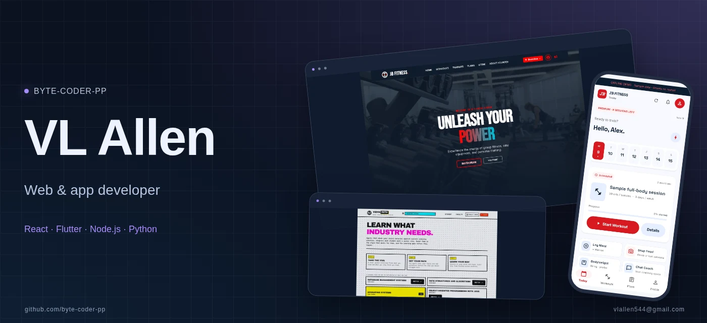
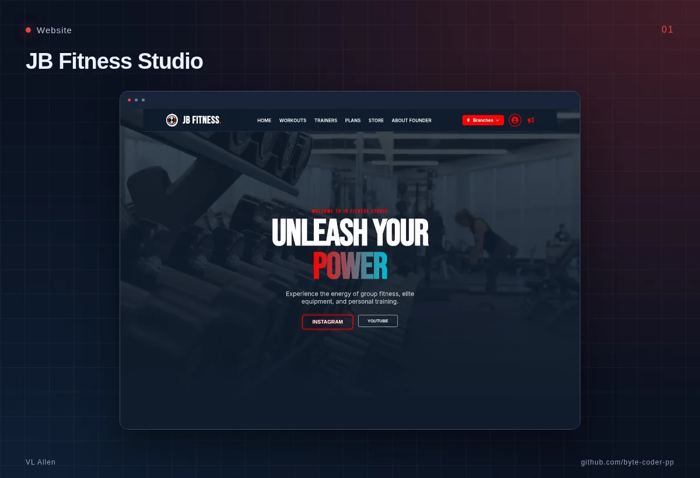
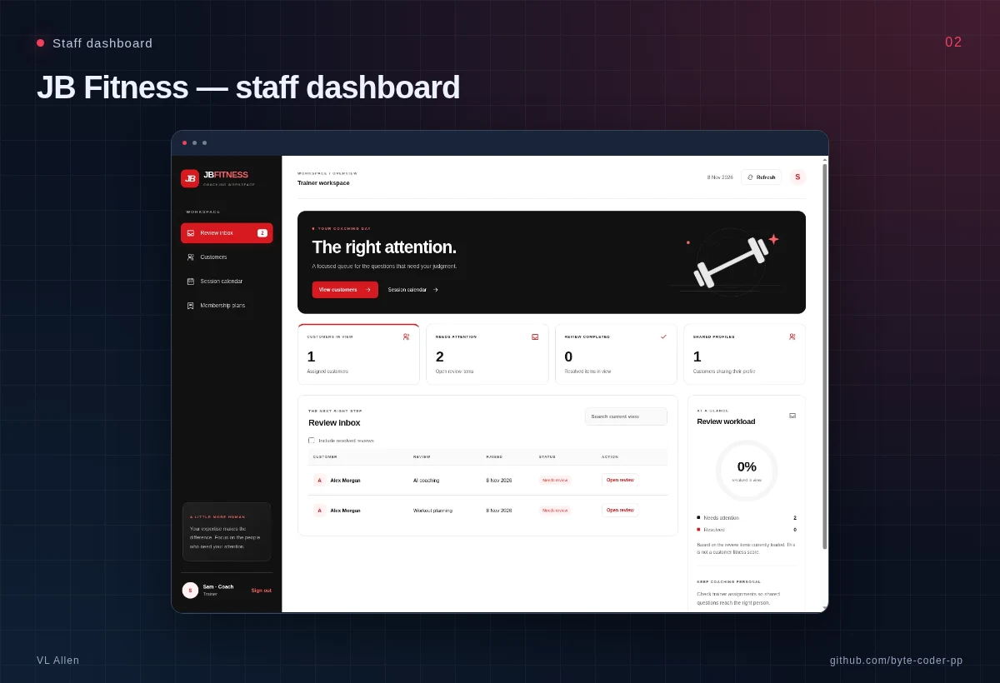
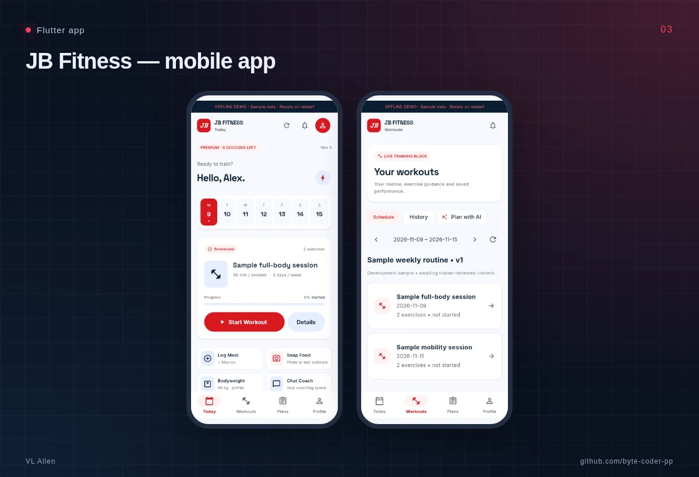
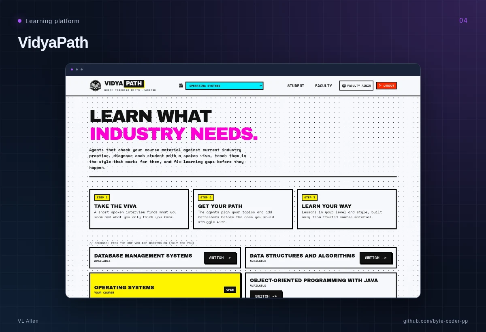
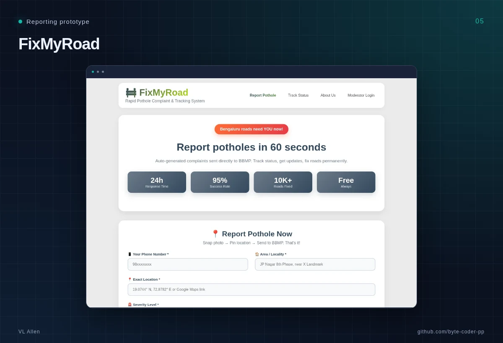
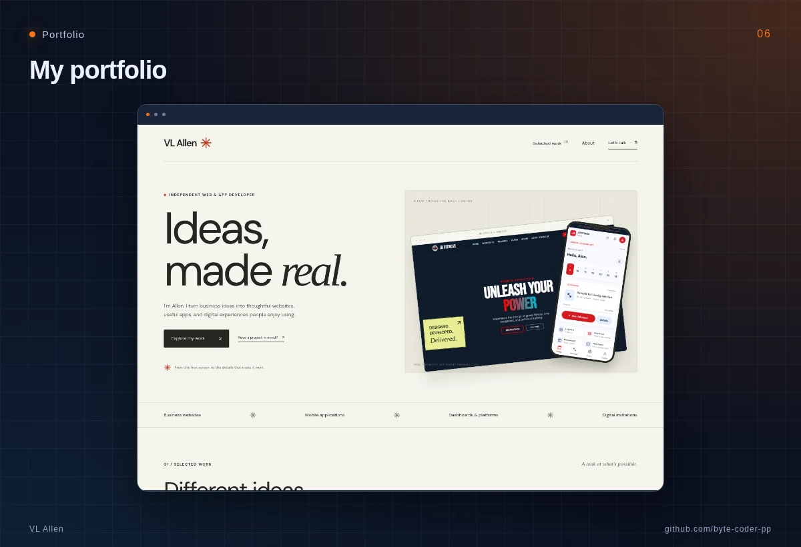
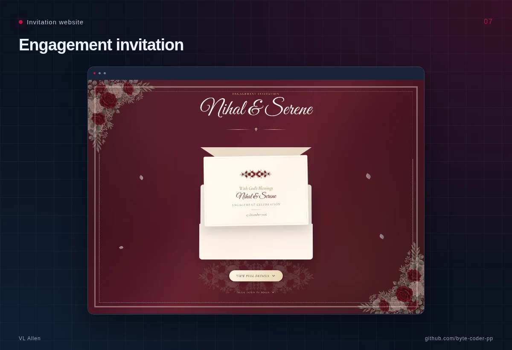
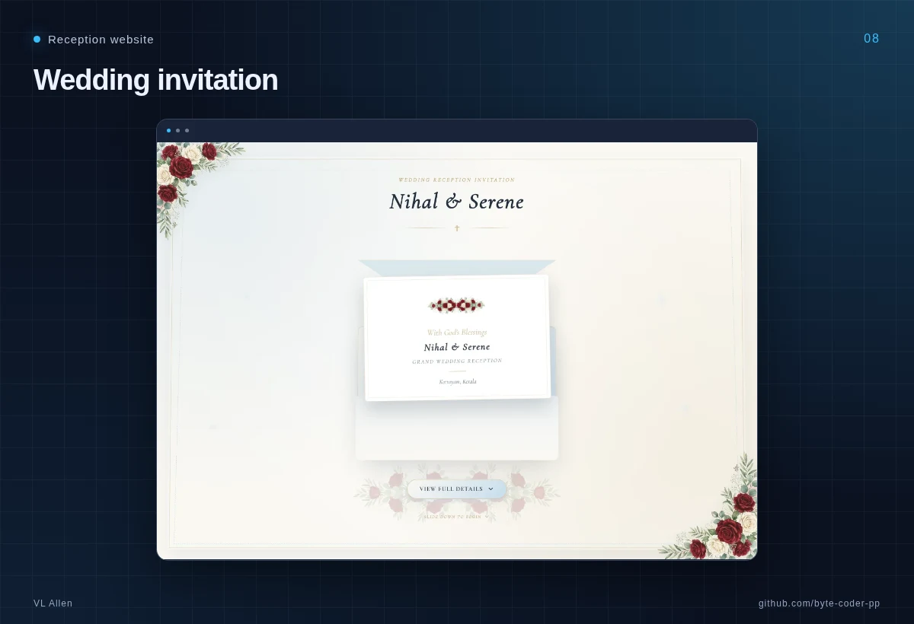

## Hi, I’m Allen

I build websites and mobile apps. This is where I keep my projects.

A lot of the work here is for JB Fitness: the gym website, a Flutter app and a dashboard for staff. I’ve also worked on a learning platform, a pothole-reporting prototype, and engagement and wedding invitation sites.

## Selected work

A few screenshots from the projects. The fitness and learning apps use sample data; FixMyRoad is a prototype.

## My repositories

| Repository | Project |
| --- | --- |
| [jbfitgym](https://github.com/byte-coder-pp/jbfitgym) | Website |
| [VidyaPath](https://github.com/byte-coder-pp/multi-model-ai-learning-platform) | Learning platform |
| [jbfitness_app](https://github.com/byte-coder-pp/jbfitness_app) | Mobile app and staff dashboard |
| [FixMyRoad](https://github.com/byte-coder-pp/FixMyRoad) | Reporting prototype |
| [jbfitnesss](https://github.com/byte-coder-pp/jbfitnesss) | Earlier website |
| [jbfitness](https://github.com/byte-coder-pp/jbfitness) | Backend |
| [client-portfolio](https://github.com/byte-coder-pp/client-portfolio) | Portfolio |
| [engagement-invitation](https://github.com/byte-coder-pp/engagement-invitation) | Invitation website |
| [wedding-invitation](https://github.com/byte-coder-pp/wedding-invitation) | Reception website |

The project repos are private. Email me if you’d like access to one. Each README has screenshots and setup steps.

## Tools I use

Full stack

| Area | Tools |
| --- | --- |
| Web interfaces | HTML, CSS, JavaScript, React, Next.js |
| Mobile | Flutter, Dart |
| Backend | Node.js, Express, NestJS, Python, FastAPI |
| Data | PostgreSQL, MongoDB, Supabase |
| Development | Git, GitHub, Vite, Docker |

## On building

<table>
<tr>
<td width="50%" valign="top"><blockquote>“What I cannot create, I do not understand.”</blockquote><a href="https://digital.archives.caltech.edu/collections/Images/1.10-29/">Richard Feynman</a></td>
<td width="50%" valign="top"><blockquote>“Honestly, most development is about getting the details right…”</blockquote><a href="https://itwire.com/business-it-news/open-source/no-highs,-no-lows-linus-torvalds-on-25-years-of-linux">Linus Torvalds</a></td>
</tr>
</table>

## Contact

If you’d like to work with me, email [vlallen544@gmail.com](mailto:vlallen544@gmail.com). Tell me a little about what you need.

**Email:** [vlallen544@gmail.com](mailto:vlallen544@gmail.com)  
**GitHub:** [byte-coder-pp](https://github.com/byte-coder-pp)
