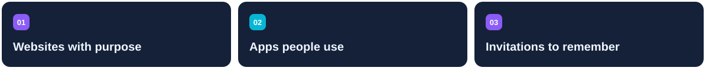
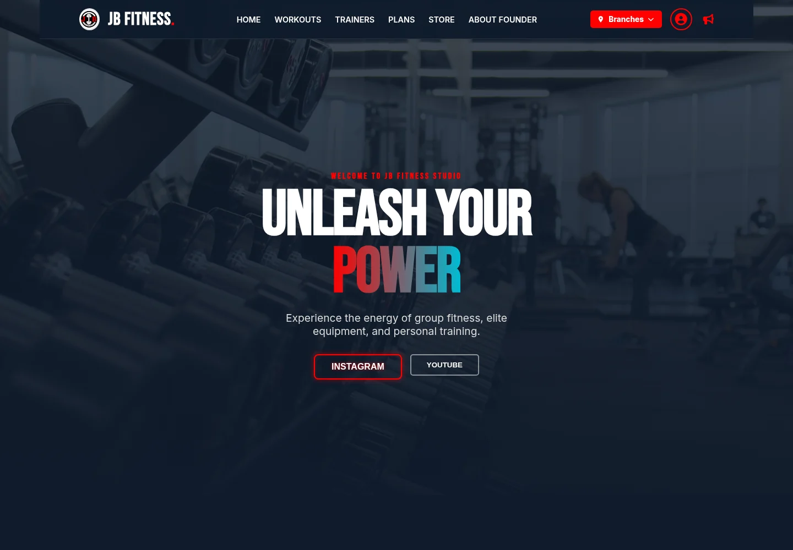
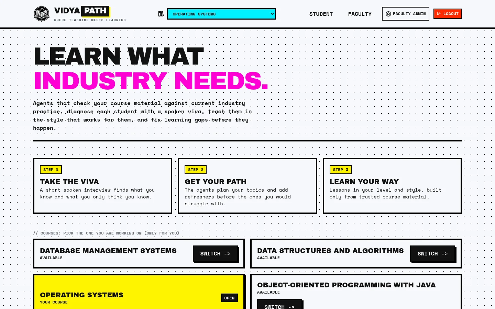
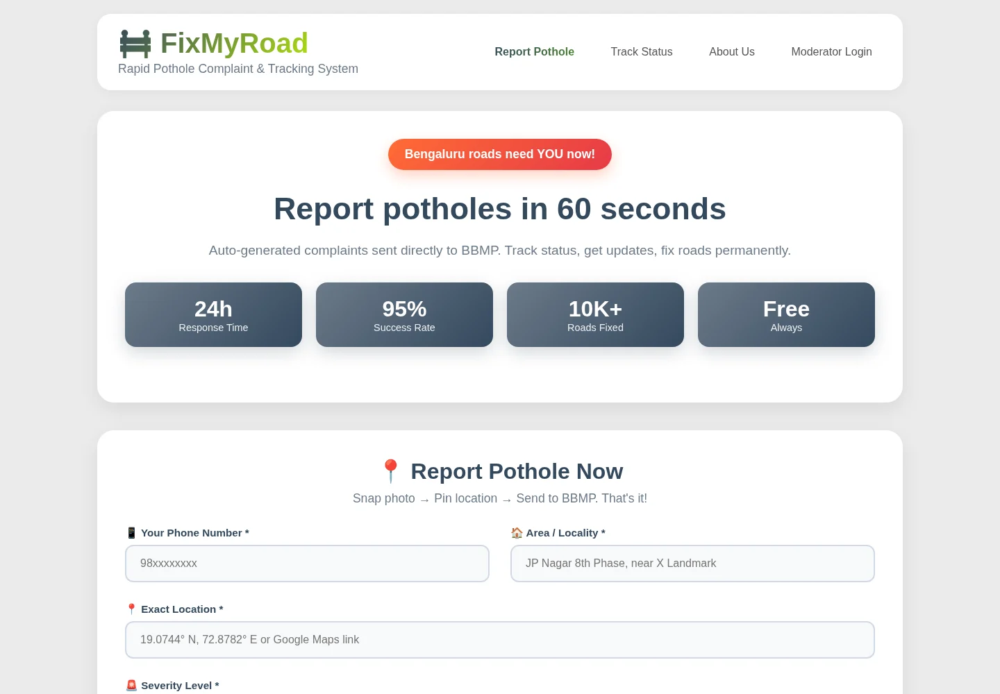
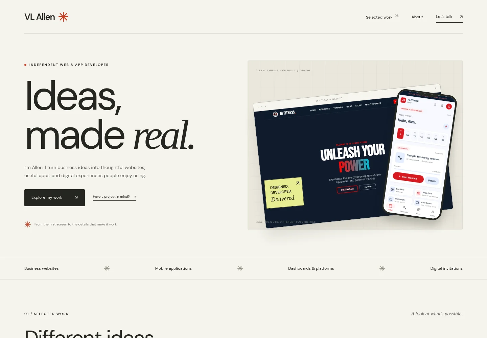
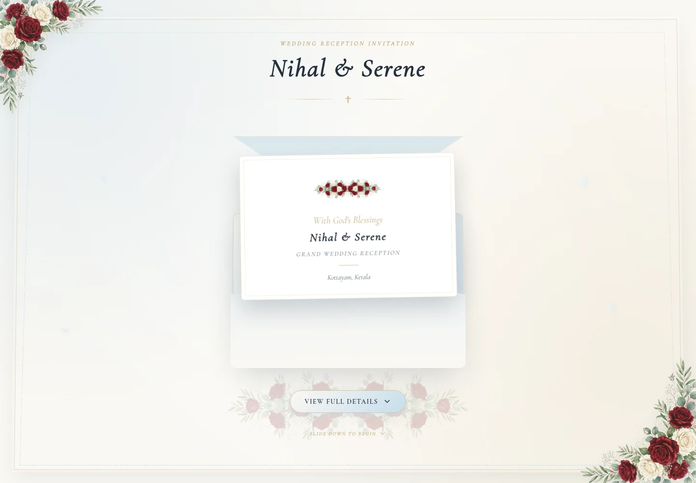
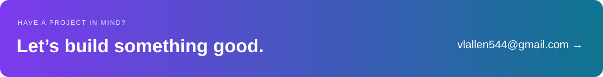

<strong>Web development · Mobile apps · Custom platforms · Digital invitations</strong>

<a href="#selected-work">See the work</a> · <a href="#my-repositories">Browse repositories</a> · <a href="#technologies-in-my-work">Explore my stack</a> · <a href="mailto:vlallen544@gmail.com">Contact me</a>

## Hi, I’m VL Allen 👋

I build business websites, mobile applications and custom digital experiences. My work connects the interface people see with the systems that make it useful: accounts, dashboards, APIs and data.

From a fitness brand’s online presence to a learning platform or a personal celebration, I care about making the experience clear, useful and enjoyable.

## Selected work

**Real interfaces from my projects.** Fitness and education screens use sample or test records; FixMyRoad is a prototype. Project source repositories are private, so repository links require access. The previews below can be viewed publicly.

<table>
<tr><td align="left" valign="top" width="50%"><strong>🔴 BUSINESS WEBSITE</strong><h3><a href="https://github.com/byte-coder-pp/jbfitgym">JB Fitness Studio</a></h3>  <a href="https://github.com/byte-coder-pp/jbfitgym"><strong>Explore repository →</strong></a></td><td align="left" valign="top" width="50%"><strong>🟣 STAFF WORKSPACE / SAMPLE DATA</strong><h3><a href="https://github.com/byte-coder-pp/jbfitness_app">JB Fitness App</a></h3>  <a href="https://github.com/byte-coder-pp/jbfitness_app"><strong>Explore repository →</strong></a></td></tr>
<tr><td align="left" valign="top" width="50%"><strong>📱 FLUTTER / SAMPLE DATA</strong><h3><a href="https://github.com/byte-coder-pp/jbfitness_app">Fitness, on mobile</a></h3>  <a href="https://github.com/byte-coder-pp/jbfitness_app"><strong>Explore mobile project →</strong></a></td><td align="left" valign="top" width="50%"><strong>🟪 AI LEARNING / DEMO</strong><h3><a href="https://github.com/byte-coder-pp/multi-model-ai-learning-platform">VidyaPath</a></h3>  <a href="https://github.com/byte-coder-pp/multi-model-ai-learning-platform"><strong>Explore repository →</strong></a></td></tr>
<tr><td align="left" valign="top" width="50%"><strong>🟢 CIVIC PROTOTYPE</strong><h3><a href="https://github.com/byte-coder-pp/FixMyRoad">FixMyRoad</a></h3>  <a href="https://github.com/byte-coder-pp/FixMyRoad"><strong>Explore repository →</strong></a></td><td align="left" valign="top" width="50%"><strong>🟠 WEBSITES &amp; APPS</strong><h3><a href="https://github.com/byte-coder-pp/client-portfolio">Developer Portfolio</a></h3>  <a href="https://github.com/byte-coder-pp/client-portfolio"><strong>Explore repository →</strong></a></td></tr>
<tr><td align="left" valign="top" width="50%"><strong>🌹 PERSONAL CELEBRATIONS</strong><h3><a href="https://github.com/byte-coder-pp/engagement-invitation">Engagement Invitation</a></h3>  <a href="https://github.com/byte-coder-pp/engagement-invitation"><strong>Explore repository →</strong></a></td><td align="left" valign="top" width="50%"><strong>🔵 DIGITAL INVITATION</strong><h3><a href="https://github.com/byte-coder-pp/wedding-invitation">Wedding Invitation</a></h3>  <a href="https://github.com/byte-coder-pp/wedding-invitation"><strong>Explore repository →</strong></a></td></tr>
</table>

## My repositories

| Project | Repository | Focus |
| --- | --- | --- |
| **JB Fitness Studio** | [jbfitgym](https://github.com/byte-coder-pp/jbfitgym) | Main fitness business website |
| **JB Fitness App** | [jbfitness_app](https://github.com/byte-coder-pp/jbfitness_app) | Flutter mobile app, staff dashboard and API |
| **VidyaPath** | [multi-model-ai-learning-platform](https://github.com/byte-coder-pp/multi-model-ai-learning-platform) | AI-assisted education platform |
| **FixMyRoad** | [FixMyRoad](https://github.com/byte-coder-pp/FixMyRoad) | Pothole reporting and complaint-tracking prototype |
| **Developer portfolio** | [client-portfolio](https://github.com/byte-coder-pp/client-portfolio) | Project galleries and invitation previews |
| **Engagement invitation** | [engagement-invitation](https://github.com/byte-coder-pp/engagement-invitation) | Burgundy/gold interactive invitation website |
| **Wedding invitation** | [wedding-invitation](https://github.com/byte-coder-pp/wedding-invitation) | Powder-blue reception invitation website |
| **JB Fitness — earlier website** | [jbfitnesss](https://github.com/byte-coder-pp/jbfitnesss) | Previous website iteration |
| **JB Fitness — legacy backend** | [jbfitness](https://github.com/byte-coder-pp/jbfitness) | Earlier API/database implementation and member form |

Each project README has a larger screenshot gallery, setup instructions and implementation notes. The older fitness website and backend are labelled separately from the main website and mobile app.

## Technologies in my work

| Area | Tools |
| --- | --- |
| 🎨 Web interfaces | HTML, CSS, JavaScript, React, Next.js |
| 📱 Mobile | Flutter, Dart |
| ⚙️ Backend | Node.js, Express, NestJS, Python, FastAPI |
| 🗄️ Data | PostgreSQL, MongoDB, Supabase |
| 🛠️ Development | Git, GitHub, Vite, Docker |

## Let’s build something

Have a website, an app or a digital invitation in mind? Send a few lines about your idea and what you need.

**Email:** [vlallen544@gmail.com](mailto:vlallen544@gmail.com)  
**GitHub:** [byte-coder-pp](https://github.com/byte-coder-pp)
