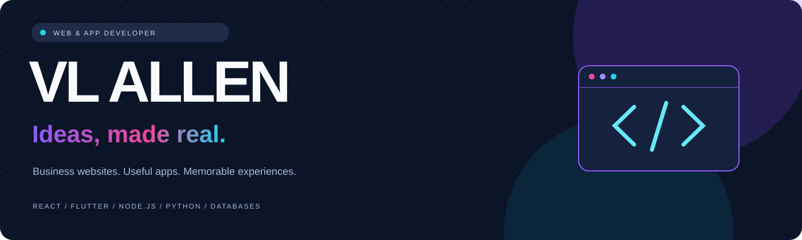
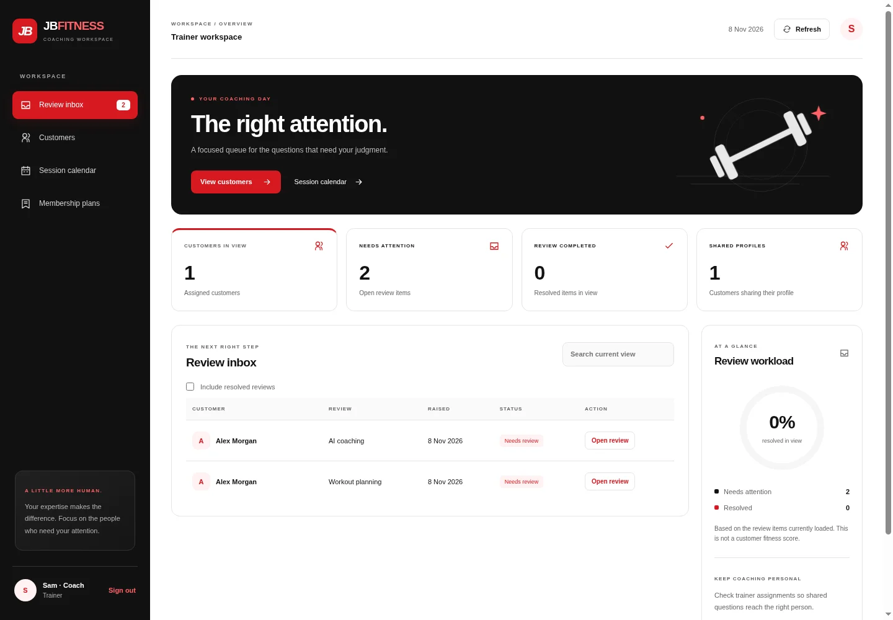
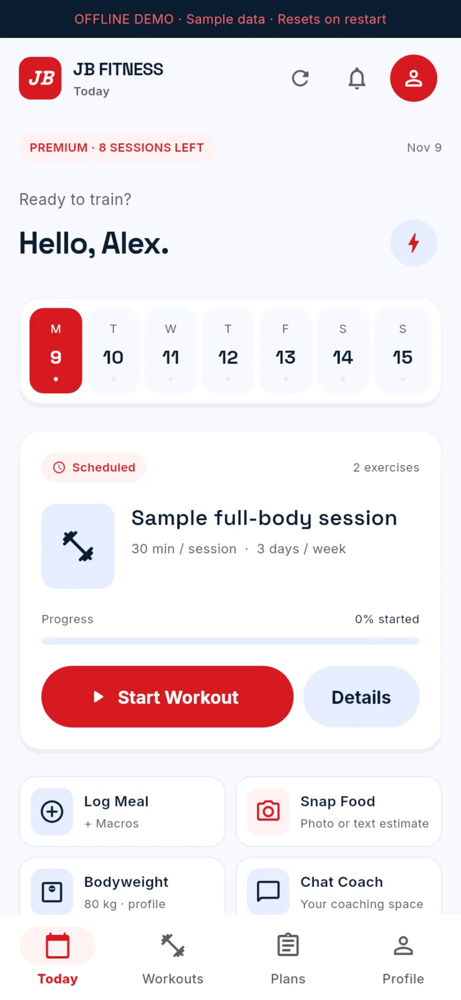
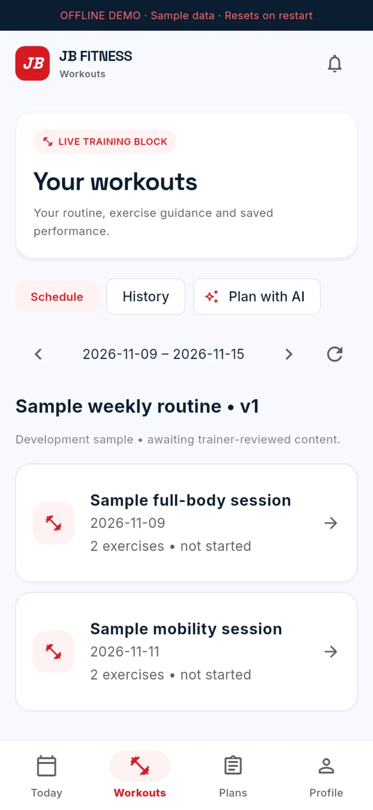

## Hi, I’m Allen

I build websites and mobile apps. This is where I keep my projects.

A lot of the work here is for JB Fitness: the gym website, a Flutter app and a dashboard for staff. I’ve also worked on a learning platform, a pothole-reporting prototype, and engagement and wedding invitation sites.

## Selected work

A few screenshots from the projects. The fitness and learning apps use sample data; FixMyRoad is a prototype.

<table>
<tr><td align="left" valign="top" width="50%"><strong>Website</strong><h3><a href="https://github.com/byte-coder-pp/jbfitgym">JB Fitness Studio</a></h3></td><td align="left" valign="top" width="50%"><strong>Staff dashboard</strong><h3><a href="https://github.com/byte-coder-pp/jbfitness_app">JB Fitness App</a></h3></td></tr>
<tr><td align="left" valign="top" width="50%"><strong>Flutter app</strong><h3><a href="https://github.com/byte-coder-pp/jbfitness_app">JB Fitness mobile app</a></h3></td><td align="left" valign="top" width="50%"><strong>Learning platform</strong><h3><a href="https://github.com/byte-coder-pp/multi-model-ai-learning-platform">VidyaPath</a></h3></td></tr>
<tr><td align="left" valign="top" width="50%"><strong>Pothole reporting</strong><h3><a href="https://github.com/byte-coder-pp/FixMyRoad">FixMyRoad</a></h3></td><td align="left" valign="top" width="50%"><strong>Portfolio</strong><h3><a href="https://github.com/byte-coder-pp/client-portfolio">Developer Portfolio</a></h3></td></tr>
<tr><td align="left" valign="top" width="50%"><strong>Engagement site</strong><h3><a href="https://github.com/byte-coder-pp/engagement-invitation">Engagement Invitation</a></h3></td><td align="left" valign="top" width="50%"><strong>Wedding site</strong><h3><a href="https://github.com/byte-coder-pp/wedding-invitation">Wedding Invitation</a></h3></td></tr>
</table>

## My repositories

| Project | Repository | Focus |
| --- | --- | --- |
| **JB Fitness Studio** | [jbfitgym](https://github.com/byte-coder-pp/jbfitgym) | Main fitness business website |
| **JB Fitness App** | [jbfitness_app](https://github.com/byte-coder-pp/jbfitness_app) | Flutter mobile app, staff dashboard and API |
| **VidyaPath** | [multi-model-ai-learning-platform](https://github.com/byte-coder-pp/multi-model-ai-learning-platform) | AI-assisted education platform |
| **FixMyRoad** | [FixMyRoad](https://github.com/byte-coder-pp/FixMyRoad) | Pothole reporting and complaint-tracking prototype |
| **Developer portfolio** | [client-portfolio](https://github.com/byte-coder-pp/client-portfolio) | Project galleries and invitation previews |
| **Engagement invitation** | [engagement-invitation](https://github.com/byte-coder-pp/engagement-invitation) | Burgundy/gold interactive invitation website |
| **Wedding invitation** | [wedding-invitation](https://github.com/byte-coder-pp/wedding-invitation) | Powder-blue reception invitation website |
| **JB Fitness — earlier website** | [jbfitnesss](https://github.com/byte-coder-pp/jbfitnesss) | Previous website iteration |
| **JB Fitness — legacy backend** | [jbfitness](https://github.com/byte-coder-pp/jbfitness) | Earlier API/database implementation and member form |

The project repos are private. Email me if you’d like access to one. Each README has screenshots and setup steps.

## Tools I use

| Area | Tools |
| --- | --- |
| Web interfaces | HTML, CSS, JavaScript, React, Next.js |
| Mobile | Flutter, Dart |
| Backend | Node.js, Express, NestJS, Python, FastAPI |
| Data | PostgreSQL, MongoDB, Supabase |
| Development | Git, GitHub, Vite, Docker |

## On building

> “What I cannot create, I do not understand.”
>
> — [Richard Feynman](https://digital.archives.caltech.edu/collections/Images/1.10-29/)

> “Honestly, most development is about getting the details right…”
>
> — [Linus Torvalds](https://itwire.com/business-it-news/open-source/no-highs,-no-lows-linus-torvalds-on-25-years-of-linux)

## Contact

If you’d like to work with me, email [vlallen544@gmail.com](mailto:vlallen544@gmail.com). Tell me a little about what you need.

**Email:** [vlallen544@gmail.com](mailto:vlallen544@gmail.com)  
**GitHub:** [byte-coder-pp](https://github.com/byte-coder-pp)
