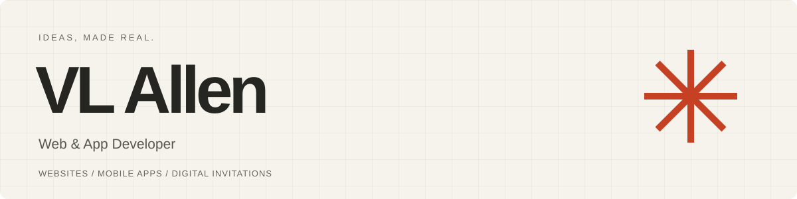

# Hi, I’m VL Allen

I build business websites, mobile applications and custom digital experiences. My work connects the interface people see with the systems that make it useful: accounts, dashboards, APIs and data.

I’m interested in projects that help a business reach customers, make a daily workflow easier, or turn a personal occasion into something memorable.

## What I work on

- **Business websites** — responsive pages, services, catalogues and clear enquiry flows.
- **Apps and dashboards** — mobile experiences and practical staff workspaces.
- **Custom platforms** — backend APIs, database-backed features and AI-assisted workflows.
- **Digital invitations** — engagement and wedding websites with personal design and interactive details.

## My repositories

| Project | Repository | Focus |
| --- | --- | --- |
| **JB Fitness Studio** | [jbfitgym](https://github.com/byte-coder-pp/jbfitgym) | Main fitness business website |
| **JB Fitness App** | [jbfitness_app](https://github.com/byte-coder-pp/jbfitness_app) | Flutter mobile app, staff dashboard and API |
| **VidyaPath** | [multi-model-ai-learning-platform](https://github.com/byte-coder-pp/multi-model-ai-learning-platform) | AI-assisted education platform |
| **FixMyRoad** | [FixMyRoad](https://github.com/byte-coder-pp/FixMyRoad) | Pothole reporting and complaint-tracking prototype |
| **Developer portfolio** | [client-portfolio](https://github.com/byte-coder-pp/client-portfolio) | Project galleries and invitation previews |
| **Engagement invitation** | [engagement-invitation](https://github.com/byte-coder-pp/engagement-invitation) | Burgundy/gold interactive invitation website |
| **Wedding invitation** | [wedding-invitation](https://github.com/byte-coder-pp/wedding-invitation) | Powder-blue reception invitation website |
| **JB Fitness — earlier website** | [jbfitnesss](https://github.com/byte-coder-pp/jbfitnesss) | Previous website iteration |
| **JB Fitness — legacy backend** | [jbfitness](https://github.com/byte-coder-pp/jbfitness) | Earlier API/database implementation and member form |

Each project README includes UI screenshots and setup details. These source repositories are private, so their links require access. Contact me for a walkthrough or to discuss repository access. Prototype content, sample records and pending integrations are labelled in the individual project documentation.

## Technologies in my work

| Area | Tools |
| --- | --- |
| Web interfaces | HTML, CSS, JavaScript, React, Next.js |
| Mobile | Flutter, Dart |
| Backend | Node.js, Express, NestJS, Python, FastAPI |
| Data | PostgreSQL, MongoDB, Supabase |
| Development | Git, GitHub, Vite, Docker |

## Let’s build something

Have a website, an app or a digital invitation in mind? Send a few lines about your idea and what you need.

**Email:** [vlallen544@gmail.com](mailto:vlallen544@gmail.com)  
**GitHub:** [byte-coder-pp](https://github.com/byte-coder-pp)
